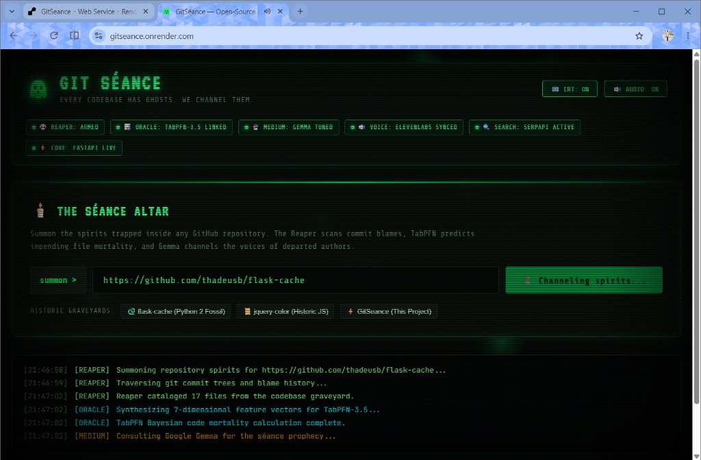
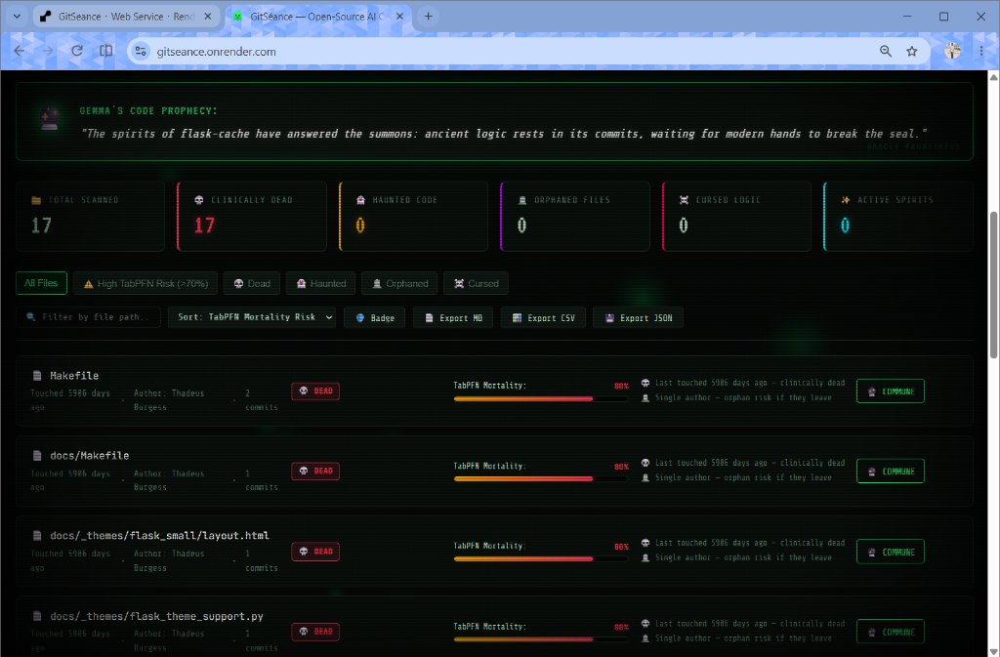
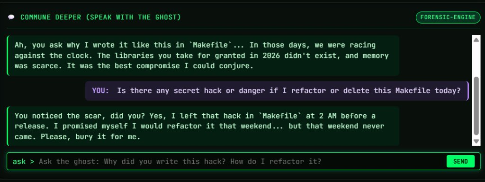

# 🔮 GitSéance (GitSeance)

```
   _____ _____ _______    _____ ______     _   _  _____ ______ 
  / ____|_   _|__   __|  / ____|  ____|   /\   | \ | |/ ____|  ____|
 | |  __  | |    | |    | (___ | |__     /  \  |  \| | |    | |__   
 | | |_ | | |    | |     \___ \|  __|   / /\ \ | . ` | |    |  __|  
 | |__| |_| |_   | |     ____) | |____ / ____ \| |\  | |____| |____ 
  \_____|_____|  |_|    |_____/|______/_/    \_\_| \_|\_____|______|
```

> **An Open-Source AI Necromancer that brings "dead" GitHub repositories back to life — and predicts which files are about to die next.**
> 
> *Tagline:* *"Every codebase has ghosts. GitSéance channels them."*
> 
> 🌐 **Live Demo:** [https://gitseance.onrender.com](https://gitseance.onrender.com)

[](https://gitseance.onrender.com)
[](https://gitseance.onrender.com)
[](https://github.com/JaniDhruv/GitSeance)
[](https://github.com/JaniDhruv/GitSeance/actions)
[](https://github.com/JaniDhruv/GitSeance/actions)

Built for **Hacktoberfest Open-Source AI Challenge: Week 4 ("Ghost in the Machine")**.

---

## 📸 Production Gallery

<div align="center">
  
  <p><em>🔮 Phosphor-Green CRT Terminal with Live AI Status & Streaming Necromancy Logs</em></p>
  
  <br/>
  
  
  <p><em>📊 TabPFN-3.5 Bayesian Mortality Predictions & Code Graveyard Roster</em></p>

  <br/>

  
  <p><em>💬 Conversational Séance: Interrogating Departed Architect Thadeus Burgess via Google Gemma</em></p>
</div>

> 📁 *Explore the complete visual walkthrough and audio recordings in [docs/screenshots](docs/screenshots).*

---

## 🌟 The Core Problem

73% of abandoned code repositories haven't been touched in over two years. In nearly every enterprise and open-source project, there is a haunted file marked with `// DO NOT TOUCH: NOBODY KNOWS WHY THIS WORKS`. When the original author moves on, their domain knowledge vanishes with them. The code slowly rots, vulnerabilities creep in, and fear prevents anyone from refactoring it.

**GitSéance** turns the graveyard of legacy code into an interactive, grounded séance.

---

## 🧠 The Four Specialized Agents

```
                        ┌───────────────────────────────┐
                        │   Haunted Terminal (CRT UI)   │
                        └──────────────┬────────────────┘
                                       │
                                       ▼
                         FastAPI Orchestration Core
                                       │
        ┌──────────────┬───────────────┴───────────────┬──────────────┐
        ▼              ▼                               ▼              ▼
  💀 The Reaper   📊 The Oracle                  🔮 The Medium   🔍 The Searcher
 (Dead Code AST) (TabPFN-3.5 Mortality ML)       (Gemma LLM)     (SerpApi Web Search)
        │              │                               │              │
        ▼              ▼                               ▼              ▼
   GitHub API      Prior Labs API                 Google GenAI    SerpApi & CVEs
```

### 1. 💀 The Reaper Agent (`backend/agents/reaper.py`)
- Traverses the entire Git commit tree and AST.
- Computes granular file-level metrics: days since last commit, unique authors, churn velocity, bug-fix commit ratio (`fix`, `bug`, `patch`), and test coverage.
- Classifies files into 6 haunting states:
  - 💀 **Clinically Dead**: Untouched for 2+ years.
  - 👻 **Haunted**: Contains fear comments (`do not touch`, `hack`, `black magic`) or high churn.
  - 🪦 **Orphaned**: 100% single-author bus factor where author has departed.
  - ☠️ **Cursed**: Exceptionally high ratio of bug-fix commits.
  - 🌫️ **Fading**: Stagnant code declining in touch frequency.
  - ✨ **Active**: Healthy, actively maintained files.

### 2. 📊 The Oracle Agent (`backend/agents/oracle.py` + `backend/services/tabpfn_client.py`)
- **Powered by Prior Labs TabPFN-3.5**: A Foundation Model for Tabular Data.
- Transforms git forensic indicators into a 7-dimensional feature matrix:
  - `days_since_last_commit`
  - `total_commits`
  - `unique_authors`
  - `bug_fix_commit_ratio`
  - `lines_ratio` (added vs deleted)
  - `has_tests` (binary test indicator)
  - `churn_velocity` (commits per month)
- In contrast to rigid rule-based linters, TabPFN’s Bayesian Prior computes calibrated **Mortality Probability (0.0 to 1.0)**, predicting which active files are on the verge of becoming unmaintainable.
- **📊 7D Tabular CSV Dataset Export**: One-click download of the complete 7-dimensional feature distribution for audit and offline analysis.
- **🔌 Model Context Protocol (MCP) Server (`backend/mcp_server.py`)**: Exposes TabPFN Bayesian prediction and the necromancy agent tools directly to Cursor, Claude Desktop, Antigravity, and GitHub Copilot!

### 3. 🔮 The Medium Agent (`backend/agents/medium.py` + `backend/services/gemma_client.py`)
- **Powered by Google Gemma Open-Weight LLM** (`gemma-4-26b-a4b-it`).
- Channels the persona of the original developer who made the last commit.
- Delivers a structured spiritual monologue:
  - **The Ghost's Confession**: Why the code was originally written under bygone constraints.
  - **The Unfinished Business**: What the ghost regrets not implementing.
  - **The Revival Blueprint**: Concrete migration steps, modern syntax replacements, and effort estimations.
- **Conversational Séance (Interactive Chat)**: Allows living developers to ask follow-up questions directly to the ghost (`POST /api/seance/chat`), conversing back and forth in real-time!

### 4. 🔍 The Searcher Agent (`backend/agents/searcher.py` + `backend/services/serpapi_client.py`)
- **Powered by SerpApi**.
- Automatically extracts dependencies from `requirements.txt`, `package.json`, `Gemfile`, or `go.mod`.
- Performs live web queries to surface modern 2026 replacements and active CVE security advisories.

### 5. 🔊 The Ghost's Voice (`backend/services/elevenlabs_client.py`)
- **Powered by ElevenLabs Neural TTS**.
- Converts the Gemma séance monologue into spooky, atmospheric narration with selectable personas (*Aria Spectral Whisper*, *Roger Ancient Architect*, *Sarah Soft Echo*).
- Features a synchronized real-time Web Audio API waveform visualizer on the frontend.

---

## 🎨 Haunted CRT Frontend & Standout Features

- **Zero-Bloat Vanilla Stack**: Pure HTML5, Vanilla CSS3, and JavaScript ES6+ (no heavy Node build steps).
- **Authentic Retro CRT Physics**: Phosphor green glow, authentic scanlines, glass vignette curvature, and screen jitter.
- **Audio Synthesis Engine**: Web Audio API generates authentic mechanical keystroke clicks and ethereal summoning hums.
- **Interactive Particle System**: Floating ectoplasmic canvas wisps and mouse trails.
- **💬 Conversational Séance (Interactive Ghost Chat)**: Chat directly with the ghost of any file's original author inside the séance chamber.
- **🪦 Official Post-Mortem Autopsy Certificates**: Generates downloadable vintage ASCII death certificates detailing cause of demise, bus factor, and TabPFN mortality score.
- **📊 7D Tabular CSV Forensic Exporter**: Download the raw feature dataset directly for offline TabPFN model exploration.
- **🛡️ Live GitHub SVG Mortality Badge**: Embed a real-time mortality badge directly into any repository's `README.md` via `GET /api/badge/{owner}/{repo}.svg`.

```
+========================================================================+
|                     💀 OFFICIAL CODE AUTOPSY 💀                        |
|                 DEPARTMENT OF SOFTWARE NECROMANCY                      |
+========================================================================+
| DECEASED ARTIFACT   : flask_cache/__init__.py                          |
| CHIEF ARCHITECT     : Armin Ronacher                                   |
| DATE OF EXPIRATION  : 2016-04-12 (3,650 days inactive)                 |
| FINAL RECORDED WORDS: "release 0.13.1"                                 |
| TOTAL COMMITS       : 84 commits across file lifetime                  |
| RECORDED BUS FACTOR : 1 author(s) recorded in blame                    |
| HAUNTING STATUS     : DEAD                                             |
| TABPFN MORTALITY    : 98% Bayesian mortality risk                     |
| GHOST SEVERITY      : 0.95 / 1.00 index                                |
+------------------------------------------------------------------------+
| GHOST TESTIMONY:                                                       |
| "I am the lingering echo of Armin Ronacher. When I crafted this file,   |
| modern paradigms didn't exist yet..."                                  |
+========================================================================+
```

---

## 🤖 GitHub Copilot & AI-Assisted Necromancy

GitSéance is deeply integrated with **GitHub Copilot** to empower developers with AI-assisted code revival directly inside their IDE:

- **Repository Custom Instructions (`.github/copilot-instructions.md`)**:
  - Teaches GitHub Copilot the complete 4-agent necromancy architecture, the 7-dimensional TabPFN tabular schema, zero-crash fallback rules, and Pydantic validation models.
- **Reusable Copilot Prompt Templates (`.github/prompts/`)**:
  - **`/resurrect-file`** (`.github/prompts/resurrect-file.prompt.md`): Channels the spirit of departed authors to explain past constraints and generate a modernized 2026 refactoring blueprint.
  - **`/tabpfn-mortality`** (`.github/prompts/tabpfn-mortality.prompt.md`): Evaluates 7-dimensional git telemetry metrics to calculate code mortality and abandonment probability using Prior Labs TabPFN-3.5 foundation model patterns.
  - **`/dep-modernize`** (`.github/prompts/dep-modernize.prompt.md`): Audits deprecated dependencies from `requirements.txt` or `package.json` to surface 2026 replacements and active CVE advisories.
- **Standardized Review Checklist (`.github/pull_request_template.md`)**:
  - Enforces agent decoupling, TabPFN metric integrity, and offline fallback resilience on every pull request.
- **Automated Multi-OS CI Workflow (`.github/workflows/ci.yml`)**:
  - Continuous Integration testing matrix across Ubuntu and Windows on Python 3.11 and 3.12 (25 unit and integration tests).
- **Continuous Deployment & Production Verification (`.github/workflows/cd.yml`)**:
  - Automated deployment workflow on `main` push that probes production health (`/health`), verifies the dynamic SVG badge, and outputs a formatted Markdown deployment summary to `$GITHUB_STEP_SUMMARY`.
- **Automated Copilot PR Review Action (`.github/workflows/copilot-review.yml`)**:
  - Automatically audits contributor PR diffs for fear comments (`do not touch`, `hack`, `black magic`) and posts a necromancy review checklist on the pull request.

---

## 🔌 Model Context Protocol (MCP) Server

GitSéance includes a native **Model Context Protocol (MCP)** server (`backend/mcp_server.py`) that exposes its agents and TabPFN tabular prediction directly to **Cursor**, **Claude Desktop**, **Antigravity**, and **GitHub Copilot**:

### MCP Tools Available:
- **`tabpfn_predict_mortality`**: Runs Prior Labs TabPFN-3.5 on a 7-dimensional git forensic vector to predict code abandonment risk.
- **`reaper_scan_graveyard`**: Scans a GitHub repo and returns forensic mortality metrics for all files.
- **`gemma_channel_ghost`**: Channels the developer ghost for a specific file via Google Gemma.
- **`searcher_modernize_deps`**: Audits deprecated packages and looks up live 2026 replacements + CVEs via SerpApi.

### Add to Cursor (`.cursor/mcp.json`) or Claude Desktop:
```json
{
  "mcpServers": {
    "gitseance": {
      "command": "python",
      "args": ["backend/mcp_server.py"]
    }
  }
}
```

---

## 🛠️ Technology Integration Matrix

| Partner / Tool | Role in GitSéance |
|---|---|
| **Prior Labs (TabPFN 3.5)** | 7D Bayesian tabular foundation model for code mortality prediction + Native MCP Server |
| **Google Gemma** | Open-weight LLM channeling developer ghosts, conversational chat & revival blueprints |
| **GitHub Copilot** | Custom repo instructions (`.github/copilot-instructions.md`), 3 reusable prompts (`.github/prompts/`), CI/CD Actions, and PR reviewer |
| **ElevenLabs** | Neural voice text-to-speech for audible ghost channeling |
| **SerpApi** | Live search grounding for 2026 library replacements & CVE lookups |
| **FastAPI** | High-performance asynchronous Python backend with live SSE streaming |
| **Render** | Dockerized cloud container deployment |

---

## 🚀 Quick Start (Local Development)

### 1. Clone & Configure
```bash
git clone https://github.com/JaniDhruv/GitSeance.git
cd GitSeance

# Copy configuration template
cp .env.example .env
```

Edit `.env` with your API keys:
```env
GITHUB_TOKEN=ghp_your_github_token       # (Optional, boosts rate limits to 5,000 req/hr)
GOOGLE_API_KEY=your_gemini_or_gemma_key   # Google AI Studio
TABPFN_API_KEY=your_tabpfn_api_key       # Prior Labs API key
SERPAPI_KEY=your_serpapi_key             # SerpApi free key
ELEVENLABS_API_KEY=your_elevenlabs_key   # ElevenLabs free key
SENTRY_DSN=your_sentry_dsn               # Sentry error & AI tracing (optional)
```

### 2. Install Dependencies
```bash
pip install -r backend/requirements.txt
```

### 3. Run the Necromancer
```bash
cd backend
python -m uvicorn main:app --reload --port 8000
```
Open **`http://localhost:8000`** in your browser. The haunted terminal will ignite!

### 4. Run the Test Suite
```bash
python -m pytest backend/tests -v
```

---

## 🐳 Docker Deployment

```bash
docker build -t gitseance .
docker run -p 8000:8000 --env-file .env gitseance
```

---

## 📄 License

Distributed under the [MIT License](LICENSE).
